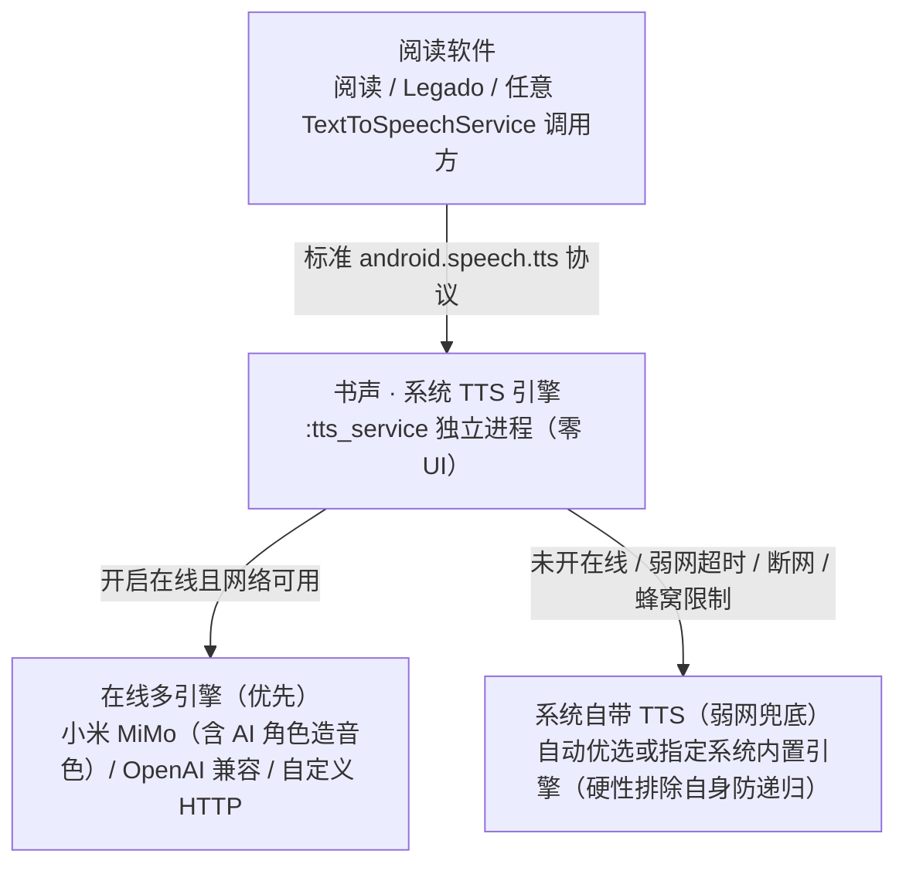

# 书声 · ebook2tts

> **v2.0.0** ｜ 作者 **Kermond** ｜ LICENSE **MIT** ｜ 包名 `com.kermond.ebook2tts`

把「多协议在线大模型 TTS」与「系统自带 TTS 自动兜底」合成为**一个轻量 Android 系统朗读引擎**：装上它，任何支持「选择 TTS 引擎」的阅读软件（阅读 / Legado / 微信读书等）都能直接朗读；**无需下载几百兆端侧语音包**，优先使用在线高清音色，遇弱网超时、断网或未开启在线时**自动无缝回退到设备自带系统 TTS**。



## 单一工作模式：在线优先 · 弱网系统兜底

| 维度 | 在线多引擎（主链路） | 系统自带 TTS（兜底链路） |
|---|---|---|
| 引擎支持 | 小米 MiMo（`mimo-v2.5-tts` / `-voicedesign`）、OpenAI `/v1/audio/speech` 兼容、自定义 HTTP 模板 | 设备已安装的系统内置或第三方 TTS 引擎（硬性过滤本应用自身） |
| 弱网保护 | 可配首包硬超时（默认 **6 秒**，支持 4/6/8/12 秒）+ 连续失败短时熔断 | 超时、断网、蜂窝未授权、未开在线或接口报错时 **0 ms–秒级自动接续** |
| 音色 | MiMo 官方 8 预置音色 + **AI 角色造音色**；OpenAI/自定义支持任意音色名 | 跟随系统引擎默认中文/英文声音与语速 |
| 语速 | 支持接口原生 `speed` 或客户端 Sonic 变速不变调（`androidx.media3`） | 直接通过系统 `TextToSpeech.setSpeechRate()` 控制 |
| 音频采集 | SSE Base64 PCM / 流式 PCM / WAV / MediaCodec 解码 MP3/AAC/OGG | 优先 `onAudioAvailable` 实时 PCM 流，未支持时自动读临时 WAV 兜底 |

## 关键能力

| 能力 | 说明 |
|---|---|
| 标准系统引擎 | 实现 `TextToSpeechService`（保留 `LocalTextToSpeechService` 入口名，覆盖升级不丢系统设置） |
| 双进程隔离 | 合成、试听与系统 TTS 转接全在 `:tts_service` 进程；UI 被杀朗读不中断 |
| 防递归兜底 | 枚举系统 `TTS_SERVICE` 时硬性过滤自身包名，强制三参 `TextToSpeech` 指定目标包名 |
| 断网/弱网无缝续播 | 请求内在线段超时或失败时，当前失败段及后续段立即改用系统 TTS，采样率不同自动重采样对齐 |
| 轻量化 | 彻底移除端侧 Sherpa-ONNX 引擎与本地模型下载链路，不内置任何模型文件 |
| 双包发布 | 提供 **Arm64 精简正式包**（主推）与 **Universal 全架构正式包**（兼容 32 位与模拟器） |

## 隐私与合规

- **默认安全回落**：未打开「启用在线朗读」或蜂窝移动网络未放行时，App 不向在线接口发送任何文本，直接使用设备本地系统 TTS。
- 开启在线合成需要用户在弹窗中**单独同意**，可随时关闭以**撤回同意**。
- 在线开启时仅将**待朗读文本**发送至用户自行配置的接口（如小米 MiMo 开放平台 / 自建兼容网关）。
- API 密钥**仅保存在本机**（MMKV 多进程存储），不上传、不转发、不使用账号体系。
- 「完整免责声明」与「Token Plan 风险说明」在 App 内设置页可随时查看：[免责声明（在线朗读）](docs/免责声明-在线朗读.md) · [Token Plan 风险确认](docs/弹窗文本-TokenPlan风险确认.md)。

## 构建与工具链

| 组件 | 版本 |
|---|---|
| JDK | 17 |
| Gradle | **9.1.0** |
| Android Gradle Plugin | **9.0.1** |
| Kotlin (KGP) | 2.3.20 |
| compileSdk / minSdk / targetSdk | **36** / **27** / **34** |
| Flutter | 3.47.4 |
| 正式包变体 | `arm64`（仅 `arm64-v8a`）与 `universal`（`arm64-v8a` / `armeabi-v7a` / `x86_64`） |

```bash
# 单测（仓库根）
./gradlew :core:test :engine:testDebugUnitTest

# Flutter Widget 测试与调试 APK
cd app && flutter pub get && flutter test && flutter build apk --debug
```

## 模块

```
core/     纯 Kotlin/JVM —— 分句与说话人抽取、MiMo 预置音色表、系统 TTS 选优与防递归、
          弱网熔断器、PCM 归一化/重采样/分块、语速映射、自定义 HTTP 模板
engine/   Android Library —— 系统 TTS 服务(:tts_service)、在线多引擎后端、首包硬超时看门狗、
          系统 TTS 兜底后端、AudioStreamDecoder、PcmSpeedStretcher(Sonic)、试听服务
app/      Flutter 界面 —— 4 页极简壳（首页 / 在线 / 朗读 / 设置）与诊断日志页
```

## CI / CD

| 工作流 | 触发 | 内容 |
|---|---|---|
| `ci.yml` | push / PR / 手动 | `:core:test` + `:engine:testDebugUnitTest` + `flutter test` + profile/debug APK |
| `release.yml` | `v*` tag / 手动 | 单测 + `flutter test` + **Arm64 & Universal 双正式签名包** + R8 去 Sherpa 守卫 |

## License

MIT · kermond369-nsis
